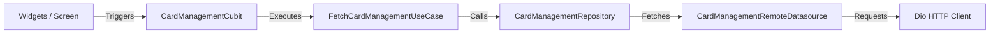

# CRED Card Management

A Flutter implementation of the CRED Card Management screen, rendering server-driven UI (SDUI) sections alongside an interactive 3D card deck. The application combines Clean Architecture, BLoC state management, and gesture-driven matrix transforms to deliver card peeling, swipe-to-reveal quick actions, long-press detail modals, and honest network failure states.

## Features

- **Server-Driven UI**: Dynamically parses and renders API sections (`cm_top_bar`, `unbilled_statement_info_section_v2`, `card_instrument_section`, `offer_banner`) using a modular `TemplateRegistry`.
- **3D Card Deck**: Custom perspective and translation matrix animations that simulate card peeling and stack depth during vertical drag.
- **Swipe-to-Reveal Actions**: Horizontal card drag opens a 3D drawer revealing 6 quick-action chips.
- **Card Detail Modal**: Long press on any card triggers a detailed modal view sheet with card benefits, statement details, and controls.
- **Pull-to-Refresh**: Background refresh on loaded states keeps existing cards visible without screen flicker; pull-to-refresh is also available on empty and error screens.
- **Honest State Handling**: Clear, dedicated UI representations for loading, empty states, and typed failures (offline, connection timeout, HTTP 429 rate limit, server error, parse error).
- **Responsive Layout**: Screen layouts and chip grids are verified to prevent layout overflow on compact devices down to 320px width.

### Unimplemented

- **Placeholder CTAs**: Interactive controls without backend endpoints (quick-action chips, statement buttons, offer banner links, top bar icons) route to a floating demo SnackBar ("Not available in this demo").
- **Local Quick Actions**: The 6 action chips revealed via horizontal swipe are defined locally in `lib/presentation/card_management/widgets/card/cred_card_deck_animator.dart` (`_DefaultActionGrid`) and not supplied by the mock API.

## Tech Stack

| Area | Choice | Version | Rationale |
| :--- | :--- | :--- | :--- |
| State Management | `flutter_bloc` | `9.1.1` | Predictable unidirectional state transitions and testable Cubits |
| Equality | `equatable` | `2.1.0` | Value-based comparisons for states and failure entities |
| Dependency Injection | `get_it` | `8.3.0` | Decoupled service locator for datasources and use cases |
| Networking | `dio` | `5.11.1` | HTTP client supporting `CancelToken` and typed exceptions |
| Network Logging | `pretty_dio_logger` | `1.4.0` | Console payload logging during development |
| Image Caching | `cached_network_image` | `3.4.1` | Memory and disk caching for remote card and bank logos |
| Linting | `flutter_lints` | `6.0.0` | Recommended static analysis rules for code quality |

## Architecture

The project follows Clean Architecture principles with strict inward dependency flow:

```
presentation  -->  domain  <--  data
      \              ^            /
       \             |           /
        +-------->  core <------+
```

- **presentation**: BLoC cubits, screens, SDUI template registry, and card animation widgets. Depends only on `domain` and `core`.
- **domain**: Business entities, abstract repository contracts, and use cases. Has no Flutter or network dependencies.
- **data**: Remote datasources, repository implementations, JSON parsing, and exception-to-failure translation.
- **core**: Dependency injection setup, environment configuration, theme, and typed `AppFailure` definitions.

### Data Flow



### Directory Structure

```text
lib/
├── core/
│   ├── config/          # AppConfig and environment variables
│   ├── constants/       # UI labels and layout constants
│   ├── di/              # GetIt dependency injection setup
│   ├── error/           # Sealed AppFailure hierarchy
│   ├── network/         # Dio client configuration
│   ├── theme/           # App colors and text styles
│   └── utils/           # Format parsers and CTA dispatcher
├── data/
│   ├── datasources/     # Remote HTTP datasource
│   └── repositories/    # Repository implementation and failure mapping
├── domain/
│   ├── entities/        # Clean domain models for SDUI sections
│   ├── repositories/    # Abstract repository contracts
│   └── usecases/        # Single-responsibility use cases
└── presentation/
    └── card_management/
        ├── cubit/       # Cubit and state representations
        ├── models/      # Local presentation models (action chips)
        ├── screen/      # Root card management screen
        └── widgets/     # Deck animator, templates, and UI states
```

### Server-Driven UI Mechanics

The API returns an array of generic section objects under `items`. In `TemplateRegistry`, each section is mapped by its `template_name` to a widget builder:

- `cm_top_bar` -> `CmTopBarTemplate`
- `unbilled_statement_info_section_v2` -> `StatementInfoTemplate`
- `card_instrument_section` -> Handled by `CredCardDeckAnimator`
- `offer_banner` -> `OfferBannerTemplate`
- **Unknown Templates**: Mapped to `UnknownSection` and rendered as `UnknownTemplate` (`SizedBox.shrink()` in production), ensuring unrecognized server sections do not crash the client.

## Key Design Decisions

| Decision | Rationale |
| :--- | :--- |
| **Typed `AppFailure` Hierarchy** | Domain-level sealed classes categorize network errors (`NoInternetFailure`, `TimeoutFailure`, `RateLimitFailure`, `ServerFailure`, `ParseFailure`, `UnknownFailure`), allowing presentation widgets to render specific graphics without parsing HTTP codes. |
| **No `connectivity_plus`** | Network reachability packages produce false positives (e.g. connected to Wi-Fi without internet). Direct socket and HTTP failure detection via Dio is reliable and avoids extra permissions. |
| **No Fallback / Mock Data** | The UI never substitutes mock data when a fetch fails. It honestly presents loading, empty, offline, or error states. |
| **Isolated `CancelToken` per Request** | Each network request receives its own `CancelToken`, cleared in a `finally` block. Superseded requests are cancelled without aborting concurrent or subsequent requests. |
| **Cancelled Requests Emit No State** | `CancelledFailure` is caught silently by the Cubit to avoid visual error flicker during screen disposal or rapid retries. |
| **Strict Schema Parsing** | Missing mandatory structures (`items`, `child_list`, `template_properties`) immediately throw `ParseFailure` instead of defaulting to empty lists, preventing corrupt payloads from masquerading as empty states. |
| **Rate-Limit Debounce Guards** | Because the mock server enforces a 5-request rate limit, duplicate `load()` and `refresh()` triggers are ignored while a network call is in flight. |
| **Overridable API Endpoint** | `AppConfig.cardManagementUrl` defaults to the mock endpoint but can be overridden at runtime via `--dart-define=CARD_MANAGEMENT_URL=...`. |

## Getting Started

### Prerequisites

- Flutter SDK: `3.44.2` (channel stable)
- Dart SDK: `3.12.2` (SDK constraint: `>=3.5.0 <4.0.0`)
- Android Studio / Android SDK (for Android execution or APK build)

### Installation and Run

```bash
# Clone the repository
git clone <repository_url>
cd cred_assignment

# Install dependencies
flutter pub get

# Run static analysis
flutter analyze

# Run unit and widget tests
flutter test

# Run on a connected device or emulator
flutter run
```

### Build

```bash
flutter build apk --debug
```

### Configuration

Override the card management endpoint using `--dart-define`:

```bash
flutter run --dart-define=CARD_MANAGEMENT_URL=https://api.mocklets.com/p87/card-management
```

Default value: `https://api.mocklets.com/p87/card-management`

_Note: No code generation (`build_runner`) is required._

## App Behavior and States

| State | Trigger | User Interface |
| :--- | :--- | :--- |
| **Loading** | Initial screen load or user tap on Retry | Full-screen loading indicator |
| **Loaded** | Server returns valid sections with cards | Top bar, statement card, 3D card deck, and offer banner |
| **Empty** | Server returns 0 cards (`cards.isEmpty`) | `EmptyStateWidget` ("No cards available") with pull-to-refresh |
| **Offline** | Network socket unreachable | `ErrorStateWidget` with disconnected icon and Retry CTA |
| **Timeout** | Connection or receive timeout exceeded | `ErrorStateWidget` with timeout icon and Retry CTA |
| **Rate Limited** | Server responds with HTTP 429 | `ErrorStateWidget` noting the 5-request rate limit with Retry CTA |
| **Server Error** | Server responds with HTTP 5xx | `ErrorStateWidget` with server error prompt and Retry CTA |
| **Parse Error** | Malformed JSON or schema type mismatch | `ErrorStateWidget` noting invalid response format with Retry CTA |
| **Refreshing** | Pull-to-refresh on loaded screen | Subtle progress spinner; cards remain on screen without flicker |
| **Refresh Error** | Refresh request fails | Existing cards remain visible; floating error SnackBar is shown |

## API

- **Endpoint**: `https://api.mocklets.com/p87/card-management` (configured in `AppConfig`).
- **Rate Limit**: The mock API enforces a limit of 5 requests per rolling time window. When exceeded, the server returns HTTP 429, mapped client-side to `RateLimitFailure`.

```json
{
  "items": [
    {
      "entity_type": "section",
      "template_name": "cm_top_bar",
      "template_properties": { "body": { ... }, "child_list": [] }
    },
    {
      "entity_type": "section",
      "template_name": "unbilled_statement_info_section_v2",
      "template_properties": { "body": { "statement": { ... } }, "child_list": [] }
    },
    {
      "entity_type": "section",
      "template_name": "card_instrument_section",
      "template_properties": { "body": { "card": { ... } }, "child_list": [] }
    },
    {
      "entity_type": "section",
      "template_name": "offer_banner",
      "template_properties": { "body": { "offer": { ... } }, "child_list": [] }
    }
  ]
}
```

## Testing

```bash
# Run all tests
flutter test

# Run tests with coverage output
flutter test --coverage
```

### Test Suites

| Test File | Tests | Protected Behavior |
| :--- | :---: | :--- |
| [`repository_failure_mapping_test.dart`](test/repository_failure_mapping_test.dart) | 27 | `DioException` mapping to `AppFailure` subtypes, real `CancelToken` lifecycle, schema type mismatches |
| [`statement_and_modal_test.dart`](test/statement_and_modal_test.dart) | 9 | Statement parsing, due count badges, long press card modal sheet trigger, sheet dismissal |
| [`error_states_test.dart`](test/error_states_test.dart) | 8 | UI rendering for offline, timeout, rate limit (429), server error, and retry CTA execution |
| [`cta_unimplemented_test.dart`](test/cta_unimplemented_test.dart) | 6 | Floating demo SnackBar for unimplemented CTAs, quick actions, single-snackbar queue |
| [`pull_to_refresh_test.dart`](test/pull_to_refresh_test.dart) | 6 | Pull-to-refresh cubit flow, cards retention during refresh, failure SnackBar, empty/error state reload |
| [`quick_actions_test.dart`](test/quick_actions_test.dart) | 5 | 3D horizontal swipe drawer, 6 quick-action chips, 2-line centered labels, 320px compact width safety |
| [`empty_state_test.dart`](test/empty_state_test.dart) | 4 | `EmptyStateWidget` visibility rules (rendered on loaded with empty cards, hidden during loading/error) |
| [`data_parsing_test.dart`](test/data_parsing_test.dart) | 3 | Full fixture parsing (`api_response.json`), datasource exception propagation, repository failure mapping |
| [`card_face_widget_test.dart`](test/card_face_widget_test.dart) | 2 | `CardFaceWidget` and deck animator rendering without overflow on 360px device dimensions |

**Test Result**: 70 tests passing (`00:04 +70: All tests passed!`).

## Code Quality and Conventions

- **Static Analysis**: Configured via `analysis_options.yaml` implementing `package:flutter_lints/flutter.yaml`.
- **Formatting**: Adheres to Dart formatting standards with comments wrapped strictly at 80 columns.
- **Documentation**: Doc comments (`///`) describe contracts, arguments, return values, and failure modes on public APIs; implementation comments (`//`) describe non-obvious *why*, not *what*.
- **Commit Style**: Conventional Commits (`feat(...)`, `fix(...)`, `test(...)`, `refactor(...)`, `docs(...)`).
